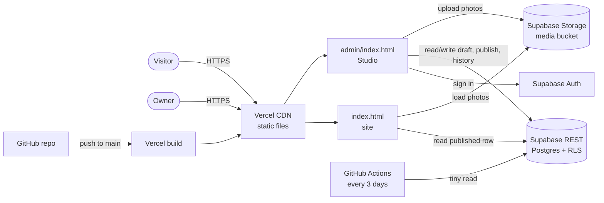
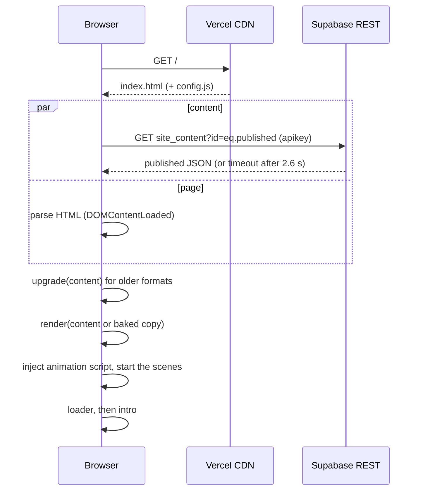
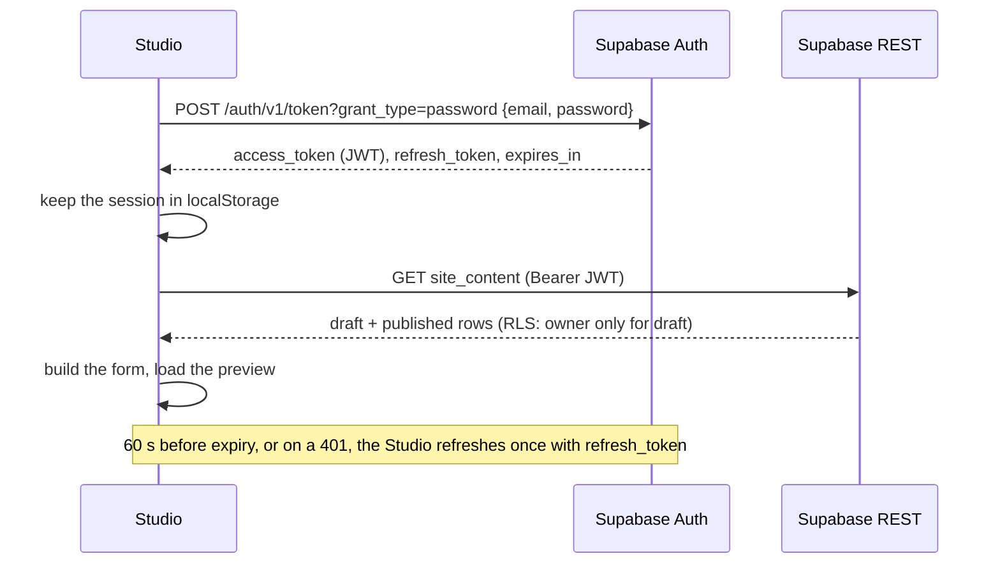
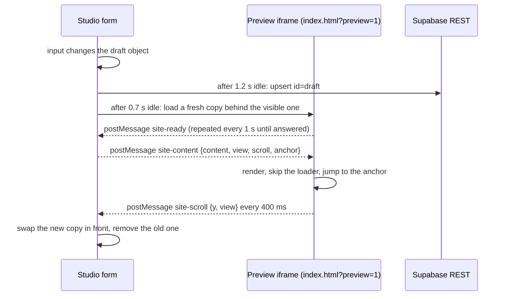
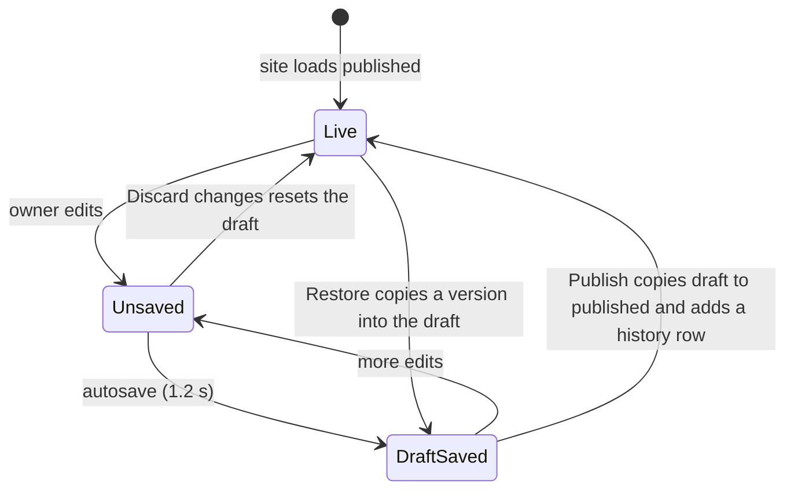
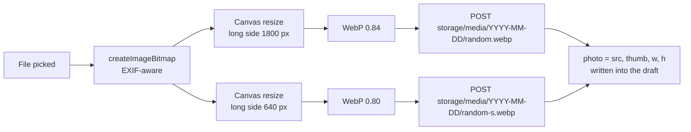
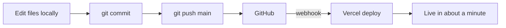
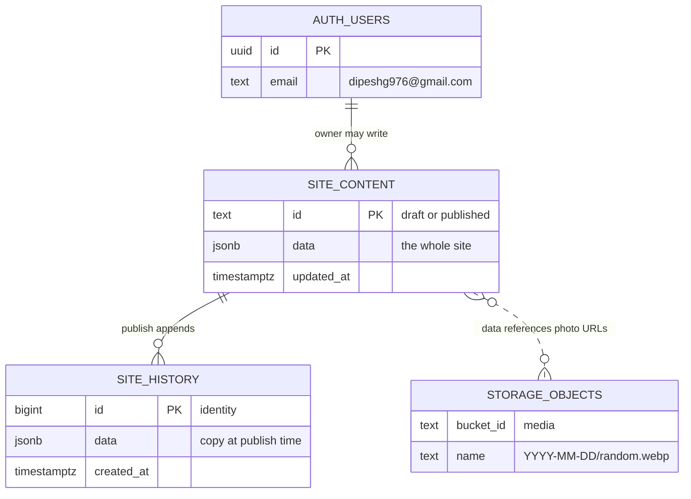

# Dipesh Gupta: Portfolio and Studio

A two-page interactive portfolio with its own content editor, the **Studio**. Every word, project, event photo and added section on the site can be changed from a browser, previewed live and published, without touching code or redeploying.

- **Live site:** hosted on Vercel from this repository
- **Editor:** `/admin/` on the same site, also opened by clicking the copyright line in the footer five times quickly
- **Current version:** v2.0.1

---

## Contents

1. [Why this exists](#1-why-this-exists)
2. [What it does](#2-what-it-does)
3. [Tech stack and why](#3-tech-stack-and-why)
4. [Repository layout](#4-repository-layout)
5. [High-level design (HLD)](#5-high-level-design-hld)
6. [Main flows](#6-main-flows)
7. [Low-level design (LLD)](#7-low-level-design-lld)
8. [Database design](#8-database-design)
9. [Security model](#9-security-model)
10. [Algorithms and data structures](#10-algorithms-and-data-structures)
11. [Performance and accessibility](#11-performance-and-accessibility)
12. [Setup from scratch](#12-setup-from-scratch)
13. [Using the Studio](#13-using-the-studio)
14. [Releases and versioning](#14-releases-and-versioning)
15. [Troubleshooting](#15-troubleshooting)
16. [Limits and costs](#16-limits-and-costs)
17. [Roadmap](#17-roadmap)

---

## 1. Why this exists

A portfolio goes stale the moment it ships: a new internship, an award, a hackathon, photos from an event. With a hand-coded site, every update means editing HTML, committing and redeploying. Many people stop updating at that point.

This project has three aims:

1. **A brand-focused site that feels crafted.** Real-time WebGL scenes, physics and scroll-driven motion, inspired by studio sites such as lusion.co but built entirely around my own resume.
2. **Content that the owner can change in minutes.** A private editor with live preview, autosaved drafts, one-click publish and full version history.
3. **Zero running cost and nothing to maintain.** Static hosting plus a managed database on free plans, no server code, and a site that keeps working even if the database is down.

Rule followed throughout: **only real resume content, nothing invented.**

---

## 2. What it does

### Page one (home)
| Section | What happens |
|---|---|
| Loader | A counter tied to real loading (fonts and page load), then the D mark breaks and reassembles |
| Hero | Physics-driven 3D D-shaped blocks in WebGL with a water ripple under the pointer |
| About | Title, text and a photo card, with lines that draw themselves as you scroll |
| Projects | Cards that tilt toward the pointer and lean with scroll speed |
| Experience | A tablet that switches between roles, with a detail panel |
| Reel | A frame that grows with the scroll and then plays a video tied to the scroll position |
| Let's talk | A heap of pieces that fall in, settle like sand and scatter under the pointer |

### Page two (more about me)
| Section | What happens |
|---|---|
| Opening | An underwater WebGL scene (seabed, light shaft, astronaut, bubble vortex) driven by the scroll |
| Roles | A dot-cloud astronaut that turns toward the pointer, with a slider of roles |
| Skills | Rows that slide with the scroll and speed up when you scroll faster |
| Education, research, publications, events | Ruled lists over giant see-through words that fill with liquid colour where the pointer stirs them |
| Events | Rows with cover photos that open a full-screen gallery |
| Awards | The page turns blue and a deck of cards fans out and turns over with the scroll |
| Let's connect | The same heap physics in a second style |

### Site-wide
- A curtain transition between the two pages, a menu that lists the sections of the page in view, a short scroll bar and a light/dark theme.
- A water effect on the page background.
- A logo that turns light over dark sections.
- The site icon.
- Email links that also copy the address.

### Studio (`/admin/`)
- Email and password sign-in for one owner account.
- A form for every part of the site, generated from a schema.
- A live preview of the real site, on desktop or phone size, that jumps to the section you are editing.
- Drafts that autosave, one-click publish, and the last 50 versions kept, each one restorable.
- Photo upload with resizing in the browser.
- Event galleries with cover selection and ordering.
- **Added sections:** new sections anywhere on either page, in five looks borrowed from existing sections.

---

## 3. Tech stack and why

| Layer | Choice | Why |
|---|---|---|
| Site | One `index.html`: HTML, CSS and vanilla JavaScript, WebGL2, Canvas 2D | No framework or build step. Full control over every frame. It loads fast and deploys as static files. |
| Editor | One `admin/index.html` in vanilla JavaScript | Same reasons. It talks to the database over plain HTTP, so no SDK is needed. |
| Hosting | Vercel (Hobby) | Free static hosting with a CDN and HTTPS, and automatic deploys on every push to `main`. |
| Database, auth, files | Supabase (Free) | Postgres with row-level security, built-in email/password auth and file storage, all reachable from the browser. |
| Source control | GitHub (private repository) | Version history, releases and the scheduled keep-alive job. |
| Scheduled job | GitHub Actions | Keeps the free database from pausing. |

There is **no backend code**. The browser talks to Supabase directly, and Postgres row-level security enforces who can do what.

---

## 4. Repository layout

```
.
├── index.html                    The whole site: markup, styles, scenes, content renderer
├── config.js                     Supabase address and public (publishable) key
├── admin/
│   └── index.html                The Studio
├── supabase/
│   └── setup.sql                 Tables, rules, photo bucket (run once in Supabase)
├── .github/workflows/
│   └── keep-alive.yml            Pings the database every 3 days
├── vercel.json                   Security headers; no-index and no-cache for /admin
├── reel.mp4, reel-poster.jpg     Video on page one and its still
├── about.jpg                     Photo on the About card (built-in default)
├── favicon.ico, favicon.svg      Site icon
├── apple-touch-icon.png          Phone home-screen icon
├── icon-192.png, icon-512.png    Icons for the web manifest
├── site.webmanifest              App name, icons and colours
├── SETUP.md                      Short setup guide
└── README.md                     This file
```

---

## 5. High-level design (HLD)

### 5.1 System context



### 5.2 Components

| Component | Responsibility |
|---|---|
| **Site shell** (`index.html`) | Markup for both pages, all styles, all scenes and controllers |
| **Content renderer** (`site_boot` script inside `index.html`) | Chooses the content source, writes every word into the page, then starts the animations |
| **Baked content** (`<script id="siteContent" type="application/json">`) | A full copy of the content inside the page, used as the fallback |
| **Studio** (`admin/index.html`) | Sign-in, schema-driven editor, preview host, publish and version history |
| **Supabase Auth** | Issues short-lived access tokens (JWT) and refresh tokens for the owner |
| **Supabase Postgres** | Stores the draft, the published content and the history, guarded by row-level security |
| **Supabase Storage** | Public bucket for photos; only the owner can write to it |
| **Vercel** | Serves the static files and redeploys on every push |
| **GitHub Actions** | Keep-alive ping |

### 5.3 Key design decisions

1. **Content as one JSON document, not many tables.** The site is one document with nested lists. A single `jsonb` value keeps reads to one request, makes publishing atomic and makes versions trivial (a version is a copy of the document). Normalising it into tables would add joins and migrations for no benefit at this size.
2. **Draft and published as two rows.** Editing never touches what visitors see until **Publish** copies the draft over.
3. **The renderer runs before the animations.** Scenes measure text and layout when they start. The content is written into the page first and the animation script is injected afterwards, so every effect sees the final words.
4. **Fail open to the baked copy.** If the database is slow (over 2.6 s), asleep or unreachable, the site renders the copy built into the page. Visitors never see a broken page.
5. **The preview is the real site.** The Studio loads the actual `index.html` in an iframe and hands it the draft through `postMessage`. What you preview is exactly what will ship.
6. **Security lives in the database, not in hidden pages.** The five-click door only makes the Studio easy to reach. The real protection is the sign-in and the Postgres row-level security.

---

## 6. Main flows

### 6.1 A visitor opens the site



### 6.2 The owner signs in



### 6.3 Editing with live preview



Two iframes are used as a double buffer: the new copy loads behind the visible one and swaps in only after it reports its first scroll position, so the preview never flashes blank.

### 6.4 Publishing and versions



**Publish** does three things in order:
1. Upsert the draft.
2. Upsert the published row with the same data.
3. Insert a history row.

The history insert is best-effort: if it fails, the site is still live.

### 6.5 Photo upload



The full-size copy is used in the photo viewer and the small one in grids and covers. Storing the width and height lets the gallery lay out rows before any image arrives.

### 6.6 Deploy pipeline



Content changes made in the Studio **do not** need a deploy. They are stored in the database and read at runtime.

---

## 7. Low-level design (LLD)

### 7.1 Content model

```text
SiteContent
├── version: 3
├── meta { title, description }
├── contact { email, address[], links[{label,url}], footerTitle, copyright }
├── home
│   ├── headline
│   ├── about { title1, title2, text, button, image, imagePos }
│   ├── projects { title, note, items[Project] }
│   ├── experience { title, items[{org, role, years, title?, where, dates, points[]}] }
│   └── talk { lead, title, next }
├── more
│   ├── opening { name, left[3], right[2], sayEm, say, say2 }
│   ├── roles { title, items[{name, role, dates, group, letter, text}] }
│   ├── skills { title, note, rows[ [ {name, group} ] ] }
│   ├── record { words[], sections[Part] }
│   ├── awards { title1, title2, note, cards[{key, title, kind, rows[{title, note}]}] }   max 5 cards
│   └── connect { lead, line1, line2, back }
└── extra[AddedSection]

Project      = { name, when, tags[], text, url, linkLabel, cover: 'blue'|'dark', coverText, image }
Part         = ListPart | EventsPart
ListPart     = { nav, title, count, groups[{ name, rows[{mark, title, note}] }] }
EventsPart   = { kind:'events', nav, title, count, events[Event] }
Event        = { title, date, place, note, cover, photos[{src, thumb, w, h}] }
AddedSection = { template: 'text'|'cards'|'list'|'events'|'rows', place: 'home:<id>'|'more:<id>', nav, title, ... }
```

**Format upgrades.** `upgrade(content, baked)` runs on every load, in both the site and the Studio. Content saved by an older version gains what newer versions added, without overwriting anything the owner wrote:
- **Version 2** adds the Events part.
- **Version 3** fills an empty About photo.

### 7.2 Site start-up sequence

1. `config.js` sets `window.SITE_CONFIG`.
2. The boot script reads the baked JSON, then starts **one** of these in parallel with HTML parsing:
   - `fromDatabase()`: a fetch with an `AbortController` and a 2.6 s timeout. Only the `apikey` header is sent, because publishable keys must not go in `Authorization`.
   - `fromAdmin()` when the URL has `?preview=1` and the page is in an iframe: a `postMessage` handshake with a 15 s fallback.
3. `Promise.all([content, DOMContentLoaded])` then:
   - `render(upgrade(content) || baked)`; if render throws, `render(baked)`.
   - The app script, stored as `<script type="text/x-app">` so the browser does not run it early, is copied into a real `<script>` and run.

### 7.3 The renderer

`render(c)` writes each section with small, pure string builders and escapes every value (`esc`). Links pass through `safeUrl`:
- **Allowed as written:** `https:`, `mailto:`, `#anchor`, `/path` and bare file names such as `about.jpg`.
- **Anything else:** gets `https://` added in front.
- **Never possible:** `javascript:` links.

Shared builders:
- `workCard`, `listRows`, `eventRows` and `part()` serve both the built-in sections and added sections.
- `placeExtras(list)` removes old added sections and inserts each new one after the section named in `place`. Several sections after the same anchor keep their order.

### 7.4 App runtime: one loop

All animation runs in **one** `requestAnimationFrame` loop (`Page`). Each module exposes `tick(dt) -> boolean`, and the loop keeps going only while some module returns `true`:

```js
const frame = (now) => {
  const dt = Math.min(.05, (now - last) / 1000);
  const busy = Trail.tick(dt) | PageWater.tick(dt) | Brand.tick() | Bend.tick(dt) | Reveal.tick()
             | Reel.tick(dt) | Scene.tick(dt) | Roles.tick(dt) | Wall.tick(dt) | Fan.tick(dt)
             | Ledger.tick(dt) | Meet.tick(dt) | Talk.tick(dt) | Bar.tick() | Extra.tick(dt);
  if (busy && !document.hidden) raf = requestAnimationFrame(frame);
};
```

- Input events and `IntersectionObserver` callbacks call `Page.kick()` to wake the loop.
- There are no scroll listeners: modules read `scrollY` inside `tick`.
- When nothing moves, the page uses no CPU.

### 7.5 Module map

| Module | Kind | Notes |
|---|---|---|
| `Stage` | WebGL2 | Hero blocks: rigid bodies (position, velocity, angular velocity, quaternion), a ripple field and theme-aware lighting. Guards against NaN on resize (`heal()`). |
| `Deep` | WebGL2 | Page-two seabed: terrain from CPU noise, light shaft, astronaut, bubble vortex, scroll-driven camera |
| `Crew` | WebGL2 | Dot-cloud astronaut that follows the pointer, falling binary, contour floor |
| `makeGlow` | WebGL2 factory | Fluid field and liquid colour inside text textures; one instance per list section (built-in plus up to three added) |
| `PageWater` | WebGL2 | Full-screen background water; per-section tone through `uBox[4]` and `uTone[4]` uniforms |
| `makeHeap` | Canvas 2D factory | Particle heap for both closing screens (`Meet`, `Talk`) |
| `makeLedger` | Controller factory | Giant words that slide with the scroll and fade, drawn by a Glow instance |
| `makeWall` | Controller factory | Scroll-speed rows (Skills and added Moving rows) |
| `Fan` | Controller | Card deck: fan out, turn over, ribbons, blue background |
| `Bend` | Controller | Scroll warp: elements stretched onto four moved corners with `matrix3d` |
| `Reveal` | Controller | One-time appear when an element passes a height on screen |
| `Trail`, `Trail2` | SVG | Lines made of cubic Bezier legs that draw with the scroll |
| `Reel` | Controller | Scroll-locked video |
| `Views`, `Curtain` | Controller | Two pages in one file; `#more` hash; pixel-grid curtain |
| `Events` | Controller | Gallery sheet, photo viewer, history-aware back button |
| `Extra` | Controller | Starts the right motion for each added section |
| `Brand`, `Bar` | Controller | Logo colour and scroll-bar colour over dark sections |

### 7.6 Studio internals

- **Schema-driven forms.** `SCHEMA` lists groups, sections and fields. Field types: `text`, `area`, `select`, `image`, `lines`, `list` (nested, with move, duplicate and delete), `gallery`, and conditional `of: (item) => fields` for added sections. One recursive `renderFields` builds every screen.
- **Paths.** Each input writes to `draft` through a path array (`['more','record','sections',3,'events',0,'title']`), using `setAt` and `getAt`.
- **Autosave.** Debounced 1.2 s. Status is derived by comparing `JSON.stringify(draft)` with the last saved and the last published JSON.
- **Preview.** Debounced 0.7 s, double-buffered iframes, `anchor` and `view` so the preview opens at the section being edited.
- **Session.** Stored in `localStorage` (`studio-session`), refreshed 60 s before expiry, and retried once on a 401. Sign-out calls `/auth/v1/logout`.
- **Demo mode.** When `config.js` is empty, the Studio runs on the baked content and saves nothing.

### 7.7 Key interfaces

| Call | Method and path | Auth |
|---|---|---|
| Read live content | `GET /rest/v1/site_content?id=eq.published&select=data` | `apikey` |
| Read all rows | `GET /rest/v1/site_content?select=id,data,updated_at` | `apikey` + owner JWT |
| Save draft or publish | `POST /rest/v1/site_content?on_conflict=id` with `Prefer: resolution=merge-duplicates` | owner JWT |
| Add history | `POST /rest/v1/site_history` | owner JWT |
| List versions | `GET /rest/v1/site_history?select=id,created_at&order=created_at.desc&limit=20` | owner JWT |
| Sign in or refresh | `POST /auth/v1/token?grant_type=password` or `refresh_token` | `apikey` |
| Upload photo | `POST /storage/v1/object/media/<path>` | owner JWT |
| View photo | `GET /storage/v1/object/public/media/<path>` | none |
| Preview handshake | `site-ready` → `site-content` → `site-scroll` (window `postMessage`) | same origin |

---

## 8. Database design

### 8.1 Entity-relationship



### 8.2 Tables

```sql
site_content (
  id          text primary key check (id in ('draft','published')),
  data        jsonb not null,
  updated_at  timestamptz not null default now()
)

site_history (
  id          bigint generated always as identity primary key,
  data        jsonb not null,
  created_at  timestamptz not null default now()
)
```

**Why this shape:**
- **The id check** caps `site_content` at two rows. Reading the live site is a primary-key lookup, O(1).
- **`jsonb` instead of normalised tables:** the document is read and written whole, and Postgres validates it as JSON. The site does not query inside the document, so no extra indexes are needed.
- **Bounded history:** an `AFTER INSERT` statement trigger (`trim_history`, `security definer`) deletes everything but the newest 50 rows. Storage stays bounded no matter how often you publish.
- **Upsert** (`on_conflict=id`) makes saving idempotent: repeating a save leaves the same state.

### 8.3 Normal form and integrity

- **Both tables are in 3NF.** Each row has one key and one value. The JSON document is treated as a single value, which is a deliberate denormalisation for whole-document reads and writes.
- **Publish is three idempotent writes.** If one fails, repeating Publish completes it. The visible site only changes when the `published` upsert succeeds, and that single statement is atomic.

### 8.4 Storage

- **Bucket:** `media`, public read, 5 MB limit per file, images only (`jpeg`, `png`, `webp`, `gif`).
- **Upload paths:** `YYYY-MM-DD/<8 random chars>.webp`, so names never collide, and each file is cached for one year (`cache-control: 31536000`).

---

## 9. Security model

| Who | Can | Cannot |
|---|---|---|
| Anyone (publishable key) | Read the `published` row; view photos | Read the draft or history; write anything; upload; create an account |
| Owner (signed in as `dipeshg976@gmail.com`) | Everything in the two tables and the bucket | Anything outside this project |
| Any other signed-in user | Read `published` only | Everything else (and sign-ups are turned off) |

How it is enforced:
- **Row-level security** is on for both tables and for storage objects. `public.is_owner()` compares the email in the signed-in user's JWT with the owner address; every write policy calls it.
- **Keys:**
  - The publishable key is public by design and only identifies the project.
  - The secret or `service_role` key is never used anywhere in the site.
  - The database password is never used by the site.
- **Injection:** every value written into HTML is escaped, and URLs pass through `safeUrl`, so no `javascript:` links are possible.
- **Headers** (`vercel.json`):
  - `X-Frame-Options: SAMEORIGIN` stops other sites from framing the pages.
  - `X-Content-Type-Options: nosniff`.
  - `Referrer-Policy`.
  - `/admin` gets `X-Robots-Tag: noindex` and `Cache-Control: no-store`.
- **Five-click door:** a convenience, not a lock. Knowing `/admin/` gives no access without the password.

Checked: the rules were tested on a local Postgres with Supabase-style `anon` and `authenticated` roles. A visitor read only the published row, history and drafts were refused, writes by another signed-in user were refused, and uploads by non-owners were refused.

---

## 10. Algorithms and data structures

| Where | Technique | Complexity | Why |
|---|---|---|---|
| Heap physics (`makeHeap`) | Verlet integration at a fixed 1/120 s step; **uniform spatial grid with linked lists** (`head[]`, `next[]`) for neighbour search; 3 relaxation passes; sleeping bodies | O(n) per step instead of O(n²) pair checks | Hundreds of pieces at 60 fps on phones |
| Heap spawn | **Inverse-CDF sampling** of a profile curve | O(log S) per sample | Pieces fall in a natural pile shape, not columns |
| Hero blocks (`Stage`) | Rigid bodies with **quaternions** for rotation; NaN guard | O(bodies) | Smooth 3D rotation without gimbal lock |
| Liquid words (`Glow`) and background water (`PageWater`) | Semi-Lagrangian advection of a velocity and dye field on ping-pong float textures; pointer strokes as line segments; domain-warped fBm for the liquid colour | O(pixels) on the GPU | Real-time fluid look without a physics engine |
| Seabed (`Deep`) | Value noise and fBm (fractal Brownian motion) on the CPU, computed once into the terrain mesh | Precomputed | Natural seabed with no runtime cost |
| Scroll rows (`makeWall`) | Exponential smoothing of scroll speed, a hysteresis threshold for direction, modulo wrap over a doubled track | O(1) per frame | Seamless infinite marquee that reacts to scroll speed |
| Scroll warp (`Bend`) | Critically damped spring; **projective transform** of 4 corners into a `matrix3d` | O(1) per element | Elements lean with speed, then settle |
| Lines (`Trail`) | Chains of **cubic Bezier** legs with matching tangents | O(points) | Corner-free hand-drawn curves |
| Gallery layout | **Justified rows** with `flex-grow` equal to each photo's aspect ratio | O(n) | Each row fills the width without cropping |
| Gallery reveal | `IntersectionObserver` batches **grouped by row** (`offsetTop` map); delay = row × 140 ms + column × 70 ms | O(n) | Photos arrive row by row |
| Studio autosave and preview | **Debounce** (1.2 s, 0.7 s) | O(1) | Few writes, no flicker |
| Studio dirty state | Snapshot comparison with `JSON.stringify` | O(size) | Simple and exact for a document this small |
| Studio form | Recursive schema walk with path arrays | O(fields) | One generic renderer for every screen |
| Versions | Bounded log (keep newest 50) | O(1) per publish | Constant storage |
| Sign-in | Token refresh with expiry check and retry once on 401 | O(1) | Long sessions without re-entering the password |
| Image upload | Bitmap decode, canvas resample, WebP encode | O(pixels) | Uploads go from megabytes to a few hundred KB |
| Content migration | Versioned `upgrade()` | O(size) | Old saved content keeps working after updates |

---

## 11. Performance and accessibility

**Performance**
- One `requestAnimationFrame` loop that sleeps when idle, and scenes that pause when off screen (`IntersectionObserver`) or when the tab is hidden.
- Device pixel ratio is capped per scene (between 1.25 and 2, lower on phones where it matters), simulation grids are small, and words are drawn into textures once rather than every frame.
- No frameworks; one HTML file for the whole site. Photos are lazy-loaded and served as resized WebP.
- The database read has a hard 2.6 s timeout, after which the baked content is used.

**Accessibility**
- `prefers-reduced-motion` turns scenes into still pictures; all text stays readable and in place.
- Text is always real HTML above the canvases: screen readers and search engines see every word, and no effect distorts it.
- Gallery and photo viewer:
  - Dialog roles and a focus trap.
  - Escape closes them, and so does the phone's back button.
  - Arrow keys and swipe move between photos.
- Every icon button has a label; the logo turns light over dark backgrounds for contrast.

---

## 12. Setup from scratch

About 30 minutes, once.

### 12.1 GitHub
1. Create a **private** repository named `portfolio`.
2. Put every file from this folder at the root, including the `admin`, `supabase` and `.github` folders:
   ```bash
   git init
   git add -A
   git commit -m "Portfolio v2"
   git branch -M main
   git remote add origin https://github.com/<you>/portfolio.git
   git push -u origin main
   ```

### 12.2 Vercel
1. Sign in at vercel.com with GitHub, then **Add New** → **Project** → import `portfolio`.
2. Framework: **Other**. Leave the build settings empty. Click **Deploy**.
3. Every push to `main` now redeploys automatically.

### 12.3 Supabase
1. Go to supabase.com → **New project**, choose region **South Asia (Mumbai)** and the Free plan. Save the database password in your notes.
2. Open **SQL Editor** → **New query**, paste `supabase/setup.sql` and **Run**. Expect "Success. No rows returned".
3. Open **Authentication** → **Sign In / Providers** and turn **Allow new users to sign up** **off**.
4. Open **Authentication** → **Users** → **Add user**. Enter the owner email and a strong password, and tick **Auto Confirm User**.

### 12.4 Connect
Copy the **Project URL** (Project Settings → Data API) and the **Publishable key** (Project Settings → API Keys) into `config.js`:

```js
window.SITE_CONFIG = {
  supabaseUrl: 'https://<project>.supabase.co',   // no /rest/v1 and no trailing slash
  supabaseKey: 'sb_publishable_...'
};
```

Commit and push.

### 12.5 Keep-alive
GitHub → **Actions** → **Keep the database awake** → **Run workflow**. A green tick with `Database answered 200` means it works. It then runs every three days by itself.

### 12.6 Check
- [ ] The site loads, with the photo on the About card and the icon in the tab
- [ ] Five clicks on the copyright line open the Studio
- [ ] Sign-in works, and a wrong password is refused
- [ ] An edit shows in the preview; **Publish** makes it appear in an incognito window
- [ ] A photo upload works
- [ ] The keep-alive run is green

---

## 13. Using the Studio

| Task | Where |
|---|---|
| Change any text | Pick the section on the left and type; the preview follows |
| Add, remove or reorder projects, roles, skills, cards, links | The lists inside each section (add, ↑ ↓, duplicate, delete) |
| Add a new kind of record (for example a certifications list) | **Education and research** → **Add list part** |
| Add an event with photos | **Events and photos** → **Add event** → **Upload photos**; the star sets the cover |
| Add a whole new section | **Added sections** → pick a look → **Where it goes** and **Name in the menu** |
| Change the About photo | **About** → **Photo on the card** → **Upload**; **Which part of the photo to keep** for tall photos |
| See it on a phone | **Phone** above the preview |
| Undo everything since the last publish | **Discard changes** |
| Go back to an older version | **Versions** → **Restore**, then **Publish** |

Looks for added sections:

| Look | Borrowed from | Motion |
|---|---|---|
| Text and photo | About | Title rises word by word; photo wipes in |
| Cards | Projects | Tilt toward the pointer; lean with scroll speed |
| List over water words | Education | Giant words fill with liquid colour under the pointer |
| Events with photos | Events | Cover photos and the full-screen gallery |
| Moving rows | Skills | Rows slide with the scroll, faster when you scroll faster |

---

## 14. Releases and versioning

Semantic versioning on GitHub releases:

| Change | Bump | Example |
|---|---|---|
| Bug fix, wording, config | Patch | v2.0.1 |
| New feature that keeps the content format | Minor | v2.1 |
| Big structural change | Major | v3.0 |

| Version | What changed |
|---|---|
| v1 | The two-page site |
| v1.1 | Header "Let's talk" goes to the contact screen; email links copy the address; liquid words no longer bend the letters |
| v2.0 | Studio, Supabase, events with galleries, added sections, site icon, About photo |
| v2.0.1 | Clearer sign-in errors; corrected database address |

---

## 15. Troubleshooting

| Symptom | Cause and fix |
|---|---|
| The Studio says it is not connected | `config.js` is empty on the live site, or the deploy has not finished. Wait for **Ready** on Vercel and press Ctrl+Shift+R |
| "Could not reach Supabase" | The URL in `config.js` is wrong. It must be `https://<project>.supabase.co` with nothing after it |
| "The key in config.js was not accepted" | Copy the publishable key again |
| "do not match a user in this Supabase project" | Wrong password, or the user was created in another project. Recreate the user with **Auto Confirm** |
| "This email is not confirmed yet" | Confirm the user, or recreate it with **Auto Confirm** |
| Saving fails with "row-level security" | Signed in with an email other than the owner address in `setup.sql` |
| The site shows older words | The database was asleep or slow, so the site used the baked copy. Open the Studio to wake it and check the keep-alive |
| A push did not deploy | Vercel → **Deployments** → **Redeploy**; check **Settings** → **Git** points at `main` |
| `git push` says no upstream | `git push -u origin main` once |
| Git warns "LF will be replaced by CRLF" | Harmless Windows line-ending notice |

---

## 16. Limits and costs

Everything runs on free plans:

| Service | Free allowance (at the time of writing) | Use here |
|---|---|---|
| Vercel Hobby | Personal, non-commercial sites; generous bandwidth | One static site |
| Supabase Free | 500 MB database, 1 GB storage, 5 GB egress per month; pauses after a week without use | Content well under 1 MB; photos a few hundred KB each; keep-alive prevents pausing |
| GitHub Actions | 2,000 minutes per month on private repositories | About 10 minutes per month |

Known limits:
- Up to 5 award cards.
- Up to 3 added "List over water words" sections get their own liquid effect; more show plain outlines.
- Added sections cannot go after the two closing screens.
- A brand-new kind of animation still has to be built in code.

---

## 17. Roadmap

- More looks for added sections (for example the card deck)
- Image alt text for every photo from the Studio
- A dedicated events page linked from the record

---

*Built and maintained by Dipesh Gupta, B.Tech CSE (AI & ML), KIET.*
